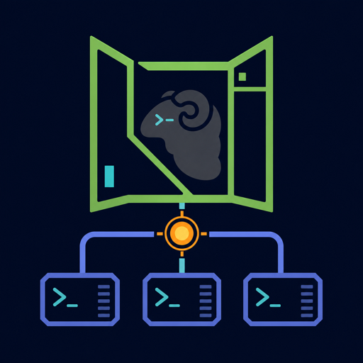
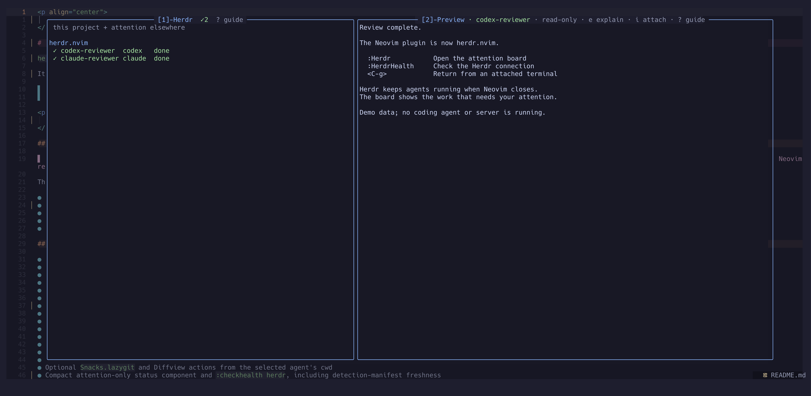
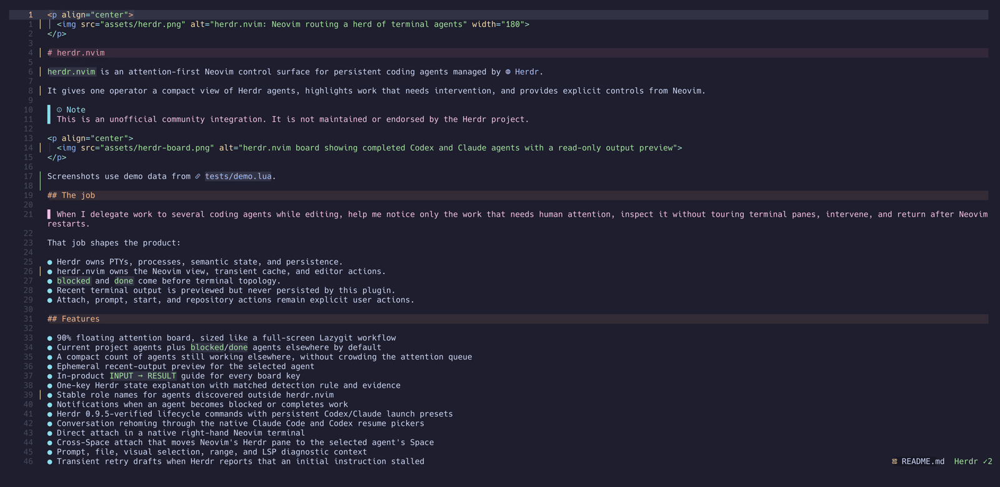

<p align="center">
  
</p>

# herdr.nvim

`herdr.nvim` is an attention-first Neovim control surface for persistent coding agents managed by [Herdr TUI](https://herdr.dev/tui/).

It gives one operator a compact view of Herdr agents, highlights work that needs intervention, and provides explicit controls from Neovim. Agents on saved Herdr SSH machines can join the same view.

It connects to the TUI runtime through the `herdr` CLI. Herdr app and `herdr-core` (`hc`) use a separate runtime; they are not supported by this plugin. Keep `herdr_cmd` pointed at `herdr`.

> [!NOTE]
> This is an unofficial community integration. It is not maintained or endorsed by the Herdr project.

<p align="center">
  
</p>

Screenshots use demo data from [`tests/demo.lua`](tests/demo.lua).

## The job

> When I delegate work to several coding agents while editing, help me notice only the work that needs human attention, inspect it without touring terminal panes, intervene, and return after Neovim restarts.

That job shapes the product:

- Herdr owns PTYs, processes, semantic state, and persistence.
- herdr.nvim owns the Neovim view, transient cache, and editor actions.
- `blocked` and `done` come before terminal topology.
- Recent terminal output is previewed but never persisted by this plugin.
- Attach, prompt, start, and repository actions remain explicit user actions.

## Features

- 90% floating attention board, sized like a full-screen Lazygit workflow
- Current project agents plus `blocked`/`done` agents elsewhere by default
- A compact count of agents still working elsewhere, without crowding the attention queue
- Ephemeral recent-output preview for the selected agent
- Pause the preview while reading or copying, with agent monitoring still active
- In-product `INPUT → RESULT` guide for every board key
- One-key Herdr state explanation with matched detection rule and evidence
- Stable role names for agents discovered outside herdr.nvim
- Notifications when an agent becomes blocked or completes work
- Herdr 0.9.5-verified lifecycle commands with persistent Codex/Claude launch presets
- Conversation rehoming through the native Claude Code and Codex resume pickers
- Direct attach in a native right-hand Neovim terminal
- Cross-Space attach that moves Neovim's Herdr pane to the selected agent's Space
- Opt-in attention across saved Herdr SSH machines, with `name@machine` targets and per-machine failure isolation
- Prompt, file, visual selection, range, and LSP diagnostic context
- Transient retry drafts when Herdr reports that an initial instruction stalled
- Optional `Snacks.lazygit` and Diffview actions from the selected agent's cwd
- Compact attention-only status component and `:checkhealth herdr`, including detection-manifest freshness
- Pure Lua with no required Neovim plugin dependency

## Requirements

- Neovim 0.10+
- Herdr 0.7.5+ (0.9.1+ here and on each saved machine to watch [other machines](#agents-on-other-machines))
- macOS or Linux
- Codex CLI and/or Claude Code

Install Herdr's richer agent integrations once:

```sh
herdr integration install codex
herdr integration install claude
```

When upgrading to Herdr 0.9.5, rerun these commands or use `:HerdrUpdateAll` to refresh existing integrations. Codex integration v10 keeps session tracking but removes turn hooks; Herdr detects Codex status from the terminal screen. Claude integration v11 fixes reporting in named sessions.

## Installation

With lazy.nvim or LazyVim:

```lua
{
  "nwiizo/herdr.nvim",
  event = "VeryLazy",
  cmd = {
    "Herdr",
    "HerdrRefresh",
    "HerdrUpdateAll",
    "HerdrStart",
    "HerdrResume",
    "HerdrAttach",
    "HerdrPrompt",
    "HerdrRename",
    "HerdrSendVisual",
    "HerdrSendFile",
    "HerdrSendDiagnostics",
    "HerdrHealth",
  },
  keys = {
    { "<C-g>", "<cmd>Herdr<cr>", mode = { "n", "t" }, desc = "Herdr agents" },
  },
  opts = {},
}
```

`<C-g>` is only a recommendation. herdr.nvim defines no global mappings itself.
`event = "VeryLazy"` starts background monitoring before the board is first opened; commands and keys can still load it earlier. With the default `auto_start_server = true`, it may also start the detached Herdr server on Neovim launch. Omit the event if you want herdr.nvim and Herdr to start only on demand and do not need ambient notifications.

### Migrating from signalbox.nvim

Update the plugin spec to `nwiizo/herdr.nvim` and move any local `dir` checkout to `herdr.nvim`. Replace `require("signalbox")` and its submodules with `require("herdr")`, `:Signalbox*` commands with `:Herdr*`, and `:checkhealth signalbox` with `:checkhealth herdr`.

Custom `User` autocmds now use `HerdrUpdated` and `HerdrAgentStatusChanged`; highlight groups use the `Herdr` prefix. Plugin filetypes and buffer names use `herdr`, and the status component displays `Herdr !1 ✓1`. Setup options and `<C-g>` are unchanged. Restart Neovim after updating; the old module and command names are not aliases. Herdr's persisted sessions need no migration.

## Workflow

Open the board with `:Herdr`.

<p align="center">
  
</p>

```text
╭───── [1]-Herdr  !1  ✓1 ─────────────╮ ╭───── [2]-Preview · reviewer · read-only ─╮
│ this project + attention elsewhere │ │ ...                                      │
│ A: 2 working elsewhere             │ │ The agent is waiting for approval to     │
│ herdr.nvim                         │ │ update the public API.                   │
│ ! reviewer       claude  blocked   │ │                                          │
│ * implementation codex   working   │ │                                          │
│ ✓ tests          codex   done      │ │                                          │
╰────────────────────────────────────╯ ╰──────────────────────────────────────────╯
```

Board mappings are buffer-local:

| Key          | Action                                                                                        |
| ------------ | --------------------------------------------------------------------------------------------- |
| `j` / `k`    | Select the next / previous agent in the list, skipping headings; scroll in the right pane     |
| `<CR>` / `i` | Leave the read-only preview and attach to the selected agent's interactive terminal           |
| `p` / `s`    | Prompt the selected agent; if blocked, show how to attach and answer its dialog                |
| `e`          | Toggle recent output / Herdr state-detection explanation                                      |
| `n`          | Give the selected agent a stable role name                                                    |
| `x`          | Acknowledge the selected completion for this Neovim session                                   |
| `a`          | Assign an unused project-based name, enter the first instruction, start, and attach            |
| `R`          | Resume a saved Claude Code or Codex conversation inside a new Herdr-managed agent              |
| `g`          | Open Snacks Lazygit at the selected agent's repository                                        |
| `d`          | Open Diffview at the selected agent's repository                                              |
| `v`          | Toggle recent-output preview                                                                  |
| `P`          | Pause / resume output updates while reading or copying                                        |
| `A`          | Toggle default attention view / all agents                                                    |
| `r`          | Refresh immediately                                                                           |
| `q`          | Close                                                                                         |
| `?`          | Replace the right pane with an input-to-result operation guide                                |
| `1` / `2`    | Focus the numbered agent-list / right pane directly                                           |
| `<Tab>`      | Move between the agent list and the right pane                                                |

The default view keeps agents from the current Git root and also surfaces blocked or completed work elsewhere. When active work is filtered out, the second line shows `A: N working elsewhere`; press `A` to reveal every agent, including those on [watched machines](#agents-on-other-machines).

Space groups are ordered by their most urgent visible agent: blocked, done, working, idle, then unknown. Equal-priority groups keep Herdr's order, with Local before watched machines, and updates preserve the selected agent.

Use `j` / `k` to move between agents without stopping on Space headings or blank rows. Movement stops at the first or last agent. `1` / `2` remain direct pane switches.

After reviewing a completed agent, press `x` from either pane to hide that completion from the default view and attention counts. `A` still shows it. Opening its preview does not acknowledge it. A new Herdr completion number or an observed transition out of `done` clears the acknowledgement, so its next completion appears again. Herdr 0.9.5 supplies completion numbers, allowing herdr.nvim to detect work completed between polls and notify once per completion even when the terminal revision stays unchanged. Older servers without this field need an observed transition out of `done`. Acknowledgements stay in memory and reset when Neovim restarts; Herdr's state is unchanged.

An empty board distinguishes no agents, agents outside the current project, reviewed completions, and a failed refresh. It offers the relevant next action and `q` to return to editing. Reviewing all completions does not suggest starting another task.

Before sending an instruction or editor context, herdr.nvim fetches a fresh snapshot from the agent's own machine and resolves the same terminal's current pane. If the agent disappears, its kind or registered name changes, or verification fails, nothing is sent. The instruction stays in a memory-only draft buffer; the notification gives a `:buffer N` command to recover it after closing the board. If submission itself fails, delivery may be uncertain: inspect the agent before explicitly retrying. Drafts are never replayed automatically or saved to disk, and are lost when Neovim exits.

For a `blocked` agent, inspect its approval or question in the preview, then press `i` or `<CR>` to answer in its native terminal. Herdr rejects ordinary prompts to blocked agents without sending input. herdr.nvim checks for this before opening the instruction input and again before sending. If the agent becomes blocked while you write, your text remains in a draft and the notification identifies the attach command. A server-side `agent_blocked` rejection also means the instruction was not sent. See [Herdr's agent input rules](https://herdr.dev/tui/docs/agent-automation/#choose-the-control-surface).

Press `?` for an `INPUT → RESULT` guide that explains the text or key to enter and the resulting action, including cross-Space attach and returning from an attached terminal. If the recent-output preview is hidden, the guide opens the right pane temporarily; pressing `?` again restores the previous preview setting.

Controls depend on the focused window and mode:

| Where you are | Read or enter text | Return or cancel |
| --- | --- | --- |
| Board / read-only preview | `j` / `k` selects agents in the list. Press `2` or `<Tab>` for the preview, then `j` / `k` or `<C-d>` / `<C-u>` to scroll. | `q` closes the board; `?` closes its guide. |
| Instruction / name input | Use the configured input dialog. With default Snacks input keys, Enter confirms or accepts completion first. | In Snacks input, close any completion menu first; Esc leaves Insert mode, then Esc cancels. Cancellation sends nothing. |
| Agent / provider picker | Use the configured picker keys to select and confirm. | Use its cancel key. The verified LazyVim/Snacks picker closes with Esc; cancellation stops the action. |
| Attached terminal, input mode | Type into the agent; Page Up / Page Down scroll Herdr history. Normal input returns to the bottom. | `<C-g>` or Herdr's `Ctrl-b`, then `q`, detaches and returns to the board. |
| Attached terminal, Neovim Normal mode | Enter this mode with `<C-\><C-n>` to select and copy terminal text. | `i` resumes input; `<C-g>` returns to the board. |
| Machine session terminal (remote agent) | That machine's full Herdr TUI; select the agent named in the notification with Herdr's own navigation. | `<C-g>` closes the session terminal and returns to the same agent on the board. |

Input and picker bindings belong to your configured UI provider; herdr.nvim keeps them intact. The terminal modes and direct-attach keys follow the [Neovim terminal manual](https://neovim.io/doc/user/terminal/#terminal-input), [Herdr direct-attach guide](https://herdr.dev/tui/docs/agents/#attach-directly-to-an-agent), and [Snacks input defaults](https://github.com/folke/snacks.nvim/blob/main/docs/input.md). In terminal input mode, press `Ctrl-b` twice to send one literal Ctrl-b to the agent. Herdr's native detach returns automatically when its terminal is focused; a background attach client exiting does not interrupt the window you are using.

Codex or Claude Code may show an update, trust, hook, login, or other setup screen before it can accept an instruction. herdr.nvim asks Herdr to confirm that the initial prompt made the agent start working. If Herdr reports `agent_prompt_stalled`, herdr.nvim warns immediately and keeps the instruction in memory. Clear the provider screen, return with `<C-g>`, select the agent, and press `p`; the original instruction is already filled in, so Enter retries it. The draft is discarded once work begins and is never written to disk.

Herdr can still misclassify Codex setup screens. The repository trust screen reproduced this with Herdr 0.9.0 / Codex 0.153.4, and the initial hook-review screen did so with Herdr 0.9.5 / Codex 0.163.0. In that case, opening a setup menu may look like a successful working transition even though the instruction was not delivered, so no retry draft is available. Finish setup in the attached terminal and resend the instruction. herdr.nvim does not duplicate Herdr's provider-screen detection.

The right pane is deliberately a read-only, ephemeral view of recent output. Its title says `read-only`; press `i` or `<CR>` from either pane to replace the board with an interactive Herdr terminal in insert mode.

To read or copy stable output, wait for the preview to load and press `P`. Its title changes to `paused`; use `2` to focus it, then scroll, select, and yank with normal Neovim keys. In-flight reads cannot replace the frozen text. Agent execution, status updates, and notifications continue. Press `P` again to fetch current output. The guide can be opened and closed without losing the frozen text; selecting another agent, switching to the state explanation, or closing the board resumes normal preview behavior. This creates no transcript file.

If a refresh or server check fails temporarily, herdr.nvim keeps the last good snapshot marked stale and retries at the configured polling interval. Missing executables and incompatible protocols stop automatic retries; resolve the problem, then use `:HerdrRefresh`. With `auto_start_server = false`, retrying never starts the server. A watched machine that fails is retried separately with a backoff, as described in [Agents on other machines](#agents-on-other-machines).

When Neovim itself runs inside Herdr and the selected Local agent belongs to another Space, attach first moves the Herdr pane hosting Neovim into that Space and follows it. Herdr keeps the Neovim process running during the move. Neovim instances outside Herdr attach without moving a pane, and remote agents never move Neovim's pane.

Use `<C-g>` (`Ctrl-g`) as the single herdr.nvim key. In a normal editor buffer it opens the board and starts Herdr on demand; in a herdr.nvim-attached terminal or machine session its buffer-local mapping takes priority, detaches the Neovim client, leaves the Herdr agent running, and returns to that same agent on the board. If the agent is outside the default filter, the board switches to all agents to reveal it. If it has disappeared, the board selects the first visible agent. A single control chord has no mapping timeout in which Codex or Claude Code can consume a partial sequence. The terminal key is configurable with `terminal.return_key`.

## Commands

| Command                              | Description                                                                          |
| ------------------------------------ | ------------------------------------------------------------------------------------ |
| `:Herdr`                         | Toggle the attention board                                                           |
| `:HerdrRefresh`                  | Refresh Herdr state immediately                                                      |
| `:HerdrUpdateAll`                | Live-handoff an outdated server, update configured integrations, and update manifests |
| `:HerdrStart [codex\|claude]`    | Choose a destination if machines are watched, assign an unused project-based name, enter the first instruction, start, and attach |
| `:HerdrResume [codex\|claude]`   | Open the provider's resume picker inside Herdr and attach                            |
| `:HerdrAttach[!] [target]`       | Attach; `!` explicitly takes over another direct client of a Local agent             |
| `:HerdrPrompt [target]`          | Prompt an agent                                                                      |
| `:HerdrRename [target]`          | Give an agent a stable role name                                                     |
| `:[range]HerdrPrompt [target]`   | Prompt with complete lines from a range                                              |
| `:'<,'>HerdrSendVisual [target]` | Prompt with the exact visual selection                                               |
| `:HerdrSendFile [target]`        | Send the saved current-file reference                                                |
| `:HerdrSendDiagnostics [target]` | Send current-buffer LSP diagnostics                                                  |
| `:HerdrHealth`                   | Run `:checkhealth herdr`                                                         |

Targets accept stable terminal IDs, current pane IDs, or an unambiguous agent name. Add `@machine` to address an agent on a [watched machine](#agents-on-other-machines), for example `reviewer@workbox` or `w1:p2@workbox`. Without `@machine`, a target that exists on Local resolves there, matching the Herdr CLI without `--machine`; otherwise it must identify exactly one remote agent. Completion offers the stable form: the terminal ID for Local agents and `terminal_id@machine` for remote agents.

## Agents on other machines

Herdr 0.9.1 can save SSH machines (`herdr machine add`) and route API commands to them with `herdr --machine`. herdr.nvim can watch those machines in the same attention board, so work delegated to another host needs no separate view.

### Set up

Save the machine in Herdr first, then list it in `machines`:

```lua
require("herdr").setup({
  machines = { "workbox" }, -- saved machine labels or profile IDs from `herdr machine list`
})
```

Run `:checkhealth herdr` to confirm that each watched machine has an enabled profile, is reachable without prompting, and runs a compatible Herdr server. Health also lists saved machines that are not watched.

Local remains the session Neovim inherits, and nothing changes until `machines` names at least one saved machine. Watched machines are polled in parallel with Local on the same cadence. Every snapshot is applied as it arrives, so a slow machine does not delay Local updates.

### On the board

A machine is one more source of attention, not a separate mode. Remote Spaces carry the machine name, and urgency ordering spans machines:

```text
╭───── [1]-Herdr  !1  *3  ✓1 ────────╮
│ this project + attention elsewhere │
│ A: 3 working elsewhere             │
│ workbox › api                      │
│ ! reviewer       claude  blocked   │
│                                    │
│ herdr.nvim                         │
│ ✓ tests          codex   done      │
╰────────────────────────────────────╯
```

The current-project filter compares local paths, so remote agents appear in the default view only when blocked or done. `A` shows all of them, and `A: N working elsewhere` counts remote work. Notifications, the preview title, and command targets name remote agents as `reviewer@workbox`.

### Acting on a remote agent

| Action | What happens |
| --- | --- |
| Preview, `e`, `n`, `p`, editor context | Runs on the agent's machine. The fresh pre-send check runs there too, so Local's server is not needed. |
| `x` | Acknowledges that machine's completion; the same terminal ID on two machines never collides. |
| `<CR>` / `i` | Herdr does not forward `agent attach`, so this opens the machine's Herdr session (`herdr --remote`) in the terminal split. A notification names the agent and pane to select there. One session terminal is reused per machine. If Herdr asks to restart the remote server, its default answer is No, and herdr.nvim never answers for you. |
| `a` / `R` | Asks where to start: Local first, then existing Spaces on watched machines, with Spaces whose directory name matches the current project first. The new tab uses that Space's absolute directory, because Herdr does not expand `~` for remote workspace or tab creation. Create a Space in Herdr first to start in a new remote project. |
| `g` / `d` | Declined: Lazygit and Diffview run locally and cannot open the remote repository. |

Editor context sent to a remote agent uses paths relative to the buffer's Git root (`@lua/foo.lua`), because the remote machine cannot resolve this machine's absolute paths. Selections and diagnostics include their text. A file reference assumes that the remote checkout has the same file; your unsaved or unsynced local edits are not included.

### When a machine fails

A failing machine never blanks the board. Its agents keep their last view, a line such as `workbox showing last view: …` explains why, and Local keeps refreshing. Retries back off from 5 to 30 seconds so an unreachable host is not hammered; `r` or `:HerdrRefresh` retries immediately. Authentication needs your terminal: run `herdr machine reconnect workbox`.

Herdr forwarding never starts, installs, or restarts a remote server, and never falls back to Local. A connection failure does not prove that a mutation was not applied, so herdr.nvim keeps a failed instruction as a draft and never resends it automatically. `:HerdrUpdateAll` maintains only Local because Herdr does not forward installation or integration commands; update each machine there.

## Rehome an existing conversation

Use `R` on the board or `:HerdrResume codex` / `:HerdrResume claude` when a conversation that started outside Herdr should become persistent and observable. Exit the original Codex or Claude Code client first. herdr.nvim never kills it or attempts to move its live process.

After confirmation, herdr.nvim creates a Herdr-managed pane, opens the provider's native resume picker, and attaches immediately. When machines are watched, it first asks where to resume; the provider's saved conversations come from that machine. Select the exact saved conversation there; herdr.nvim deliberately does not choose the latest session because multiple conversations may share one repository. Current Herdr integrations then report the native session identity so Herdr can restore that conversation after a server restart.

`:checkhealth herdr` reads Herdr's active detection-manifest status without changing it. A missing check time or one older than seven days is a warning with the explicit `herdr server update-agent-manifests` recovery command; local overrides are reported separately because they intentionally shadow remote rules.

`:HerdrUpdateAll` is the explicit maintenance path. It preserves panes by live-handoffing only when the running server is incompatible, installs outdated or missing Codex/Claude integrations that are present in `agents`, then updates Herdr's detection manifests. With Herdr 0.9+, endpoint compatibility determines whether the server can stay running, independently of its private protocol version; older clients retain their protocol check. It does not install or upgrade the Herdr binary because herdr.nvim does not own its package manager.

## Ambient status

`statusline()` returns only states that need attention:

```lua
require("herdr").statusline()
-- "Herdr !1 ✓1" or "" when there is nothing to handle
```

It can be used from Incline, lualine, or another renderer after herdr.nvim is loaded. Counts include watched machines. `~` marks last-known data after a refresh failure on Local or any watched machine.

## Notifications

herdr.nvim observes Herdr's semantic agent state and sends a Neovim notification once when an agent changes to `blocked` or `done`. It does not forward Herdr's own toast. The initial snapshot stays quiet, while `statusline()` and the board still expose existing attention.

`HerdrAgentStatusChanged` event data carries Herdr's `terminal_id`, the agent's `machine` (`nil` for Local), and its herdr.nvim `key` (`terminal_id`, or `terminal_id@machine` for a watched machine).

Blocked notifications are suppressed while the board is open or the matching live attached terminal is focused because the approval state is already visible. Completion notifications are always delivered through the current `vim.notify` provider, including while an attention surface is visible. Closing a surface alone does not replay a suppressed blocked event; if the agent leaves the attention state and later returns, the new transition can notify normally. An already delivered notification stays deduplicated for the same agent and Herdr revision. Herdr's `[ui.toast]` delivery is configured independently; enabling both a Herdr desktop/terminal toast and herdr.nvim notifications intentionally produces two notification surfaces.

## Configuration

```lua
require("herdr").setup({
  herdr_cmd = "herdr",
  auto_start_server = true,
  agent_start_timeout_ms = 30000,

  agents = {
    codex = { args = {} },
    claude = { args = {} },
  },

  -- Saved Herdr SSH machines to watch alongside Local (labels or profile IDs).
  machines = {},

  refresh = {
    board_ms = 1000,
    background_ms = 5000,
    timeout_ms = 3000,
  },

  board = {
    width = 0.9,
    height = 0.9,
    preview = true,
    preview_ratio = 0.58,
    preview_lines = 80,
  },

  terminal = {
    side = "right",
    width = 0.4,
    auto_insert = true,
    return_key = "<C-g>",
  },
})
```

Agent `args` are appended after Herdr's canonical agent command without using a shell:

```lua
agents = {
  codex = { args = { "--profile", "work" } },
}
```

## Safety and current limits

- External commands use argv arrays; editor content is never interpolated into a shell command.
- Context larger than the configured line or byte limit is rejected.
- File references reject unnamed and modified buffers.
- Closing Neovim stops only local attach clients, never Herdr agents or its server.
- Moving Neovim out of a Space where it is the last pane lets Herdr close that now-empty source Space.
- herdr.nvim cannot adopt a live process from a terminal Herdr does not own; stop that client, then use `:HerdrResume`.
- Resume rehomes saved conversation state, not a running process; stop the original client before selecting its session.
- Current-project filtering uses the Git root. Outside a Git worktree, herdr.nvim matches the exact working directory.
- herdr.nvim currently refreshes snapshots on a short adaptive poll. Herdr socket events are the next transport milestone.
- herdr.nvim observes the Herdr server selected by the CLI environment plus the saved machines listed in `machines`. Switching machines in Herdr's own UI does not retarget herdr.nvim, and `--current` never identifies a remote pane.
- Remote attach opens the machine's whole Herdr session because Herdr does not forward single-agent attach; select the agent there.
- Agent-to-Neovim MCP tools and native diff review are deliberately out of scope for v0.1.
- Windows is not supported in v0.1.

## Herdr upgrade monitoring

The repository checks the canonical `herdrdev/herdr` latest stable release daily. If it differs from the currently verified Herdr version (currently 0.9.5), GitHub Actions opens a deduplicated compatibility-audit issue with CLI, schema, and real-agent smoke-test checkpoints. See [the upstream audit runbook](docs/upstream-herdr.md).

See [the design notes](docs/design.md) for the job model and ownership boundary.

## Development

```sh
make check
```

Tests run in a clean headless Neovim and do not require a test framework plugin.
They clear inherited Herdr pane context so running them inside Herdr cannot move your pane. See [verification and disposable tests](docs/testing.md) for the real CLI, UI, and saved-machine checks.

## License

Friend License (MIT-equivalent).
